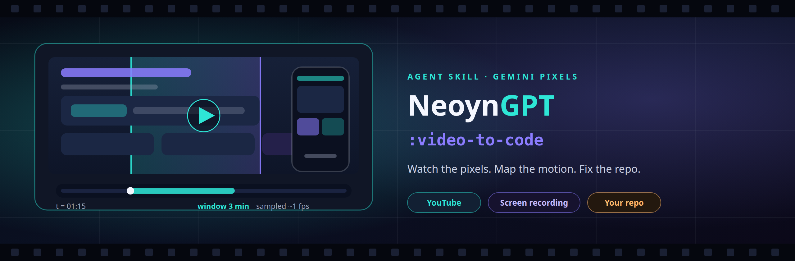
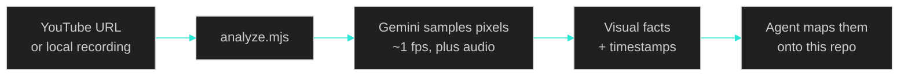

<p align="center">
  
</p>

<p align="center">
  <a href="https://www.npmjs.com/package/neoyngpt-video-to-code"></a>
  <a href="https://www.npmjs.com/package/neoyngpt-video-to-code"></a>
</p>

<p align="center">
  
  
  <a href="#harness-support"></a>
  
  <a href="https://www.npmjs.com/package/neoyngpt-video-to-code"></a>
</p>

<p align="center">
  <strong>Paste a public YouTube link or drop a screen recording.</strong><br>
  Gemini looks at <em>what is on screen</em> — layout, motion, icons, mascots, widgets, jank —<br>
  then your coding agent — in <em>any harness</em> — maps that onto the repo you have open.
</p>

<p align="center">
  <a href="#harness-support">Harness</a> ·
  <a href="#download">Download</a> ·
  <a href="#use-it">Use it</a> ·
  <a href="#what-you-get-back">Output</a> ·
  <a href="#limits">Limits</a> ·
  <a href="#troubleshooting">Troubleshooting</a>
</p>

---

## What this is

**NeoynGPT:video-to-code** is an [agent skill](https://github.com/saurav-shakya/NeoynGPT-video-to-code) plus a small CLI. It does **not** play YouTube inside the editor. It sends a public YouTube URL (or uploads a local `.mp4` / `.webm` / `.mov`) to **Gemini**, samples the pixels, and returns visual notes **any Agent Skills harness** can act on.

It is not locked to one tool. Cursor, Claude Code, Codex, [Antigravity CLI](https://antigravity.google/docs/cli/plugins/) (`agy`), and any other host that loads `SKILL.md` all work. Gemini CLI moved to Antigravity CLI — use that.

| You have… | You ask… | You get… |
| --- | --- | --- |
| A **public** YouTube demo | “How does that tab animate?” | Timestamps + motion/layout notes, then 3 takeaways for **this** repo |
| A **screen recording** of your app | “At 0:08 the sheet janks — what’s on screen and how do we fix it?” | Named bug + a fix in the open codebase |

It is **not** a transcript tool. If you only care about what someone *said*, use captions instead.

---

## Harness support

A **harness** is the agent runner (IDE chat or terminal) that loads skills and lets the model call tools. This repo ships a standard `SKILL.md`, so it supports **all** Agent Skills harnesses — not a Cursor-only or Claude-only plugin.

| Harness | Where the skill lives | Invoke |
| --- | --- | --- |
| **Cursor** | `~/.cursor/skills/neoyngpt-video-to-code` | Agent chat → `/neoyngpt-video-to-code` |
| **Claude Code** | `~/.claude/skills/neoyngpt-video-to-code` | `/neoyngpt-video-to-code` |
| **Codex** | `~/.agents/skills/neoyngpt-video-to-code` | `/neoyngpt-video-to-code` |
| **Antigravity CLI** (`agy`) | `~/.gemini/antigravity-cli/skills/` or project `.agents/skills/` | `/neoyngpt-video-to-code` |
| **Any other Agent Skills host** | copy `skills/neoyngpt-video-to-code` into that host’s skills folder | slash command or paste a YouTube URL |

The vision step always uses the **Gemini API** (`GEMINI_API_KEY`). The harness is whoever runs the skill afterward.

---

## How it works



1. You paste a **public** YouTube URL **or** attach a recording, plus a **visual** question.
2. The skill runs `scripts/analyze.mjs` (Agent mode only — it shells out to Node).
3. Gemini watches a time window (default **3 minutes** if a start time exists).
4. Stdout is treated as **ground truth for pixels**, not as code. The agent then applies it here.

Honesty: this is **sampled** video, not a frame-perfect 60 fps watch. You can say a tab slides with a bounce. You cannot invent `damping: 0.82` unless that number is on screen.

---

## Download

Need **Node 18+** and a **Gemini API key** from [Google AI Studio](https://aistudio.google.com/apikey). Pick **one** path.

| I want… | Download this |
| --- | --- |
| The skill in **any harness** (Cursor, Claude Code, Codex, Antigravity CLI, …) | [From GitHub](#install-the-skill-any-harness) |
| The **CLI** on my machine | [From npm](#cli-from-npm) |
| The full source to hack on | [Clone the repo](#clone-the-repo) |

Latest code always lives on [`main`](https://github.com/saurav-shakya/NeoynGPT-video-to-code).

### Install the skill (any harness)

Installs from **GitHub** (latest `main`) into every common harness folder:

```bash
npx skills add saurav-shakya/NeoynGPT-video-to-code -g
```

Then once, in the folder your harness uses:

```bash
cd ~/.cursor/skills/neoyngpt-video-to-code          # Cursor
# cd ~/.claude/skills/neoyngpt-video-to-code         # Claude Code
# cd ~/.agents/skills/neoyngpt-video-to-code         # Codex / project-style hosts
# cd ~/.gemini/antigravity-cli/skills/neoyngpt-video-to-code   # Antigravity CLI
npm install
```

**Antigravity CLI** (replaces Gemini CLI) — after the copy, you can also drop the skill at the project root:

```bash
mkdir -p .agents/skills
cp -R skills/neoyngpt-video-to-code .agents/skills/
# then: agy   →  /neoyngpt-video-to-code
```

**Claude Code plugin** (same repo):

```text
/plugin marketplace add saurav-shakya/NeoynGPT-video-to-code
```

Then install **neoyngpt-video-to-code**. No plugin? Copy `skills/neoyngpt-video-to-code` into that harness’s skills folder and run `npm install` there.

In Cursor: **Agent** mode → new chat → `/neoyngpt-video-to-code` or paste a YouTube URL. Ask / Chat mode cannot run this. Same idea in Claude Code, Codex, and Antigravity CLI (`agy`): the harness must be allowed to run shell.

### CLI from npm

Installs from **[npm](https://www.npmjs.com/package/neoyngpt-video-to-code)**:

```bash
npm install -g neoyngpt-video-to-code
```

Try it:

```bash
neoyngpt-video-to-code --help

neoyngpt-video-to-code --url "https://www.youtube.com/watch?v=jSWuepkuFrU&t=75s" \
  --question "How does the calorie tracker UI feel? What’s moving on the right?"

neoyngpt-video-to-code --file ./recording.mp4 \
  --question "The tab transition stutters. What is on screen?"
```

No global install — one-off:

```bash
npx neoyngpt-video-to-code --help
```

Need the GitHub commit *before* it hits npm?

```bash
npm install -g github:saurav-shakya/NeoynGPT-video-to-code
```

### Clone the repo

```bash
git clone https://github.com/saurav-shakya/NeoynGPT-video-to-code.git
cd NeoynGPT-video-to-code
npm install
npx neoyngpt-video-to-code --help
```

### Set your Gemini key

Required for every path. Either export it, or copy [`.env.example`](.env.example) to `.env` in the project (gitignored). `GOOGLE_API_KEY` works as a fallback.

```bash
export GEMINI_API_KEY=your_key
# optional
# export GEMINI_MODEL=gemini-3.8-flash
```

```bash
# .env
GEMINI_API_KEY=your_key
```

### Update later

```bash
# Skill — latest GitHub
npx skills add saurav-shakya/NeoynGPT-video-to-code -g

# CLI — latest npm
npm install -g neoyngpt-video-to-code@latest

# Clone
git pull origin main && npm install
```

---

## Use it

### In your harness

This skill **cannot** run in Ask / Chat (read-only) mode. The harness must be able to run Node (Cursor **Agent**, Claude Code, Codex, Antigravity CLI `agy`, or any other Agent Skills host). Start a **new** session, then type `/neoyngpt-video-to-code` or paste a YouTube URL.

Cursor loads skills from `.cursor/skills/` and `~/.cursor/skills/`. Antigravity CLI loads `~/.gemini/antigravity-cli/skills/` and project `.agents/skills/`. This repo already links the skill under `.cursor/skills` and `.agents/skills`. Confirm in your harness’s skill list.

The agent **must** run `scripts/analyze.mjs` before answering visual questions. If it did not run, it did not watch the video.

**YouTube demo**

> https://www.youtube.com/watch?v=jSWuepkuFrU&t=75s
> How does the calorie tracker UI feel? What’s moving on the right?

**Your app’s recording**

> [attach bug.mp4]
> At 0:08 the tab janks. What’s on screen, and how do we fix it in this repo?

Prefer a timestamp on long videos (`t=75s` in the link, or say “start at 1:15”).

### Good questions vs the wrong tool

| Ask this | Not this |
| --- | --- |
| How does the sheet expand from the mic? | Summarize what they said |
| Line vs filled tab icons — which is selected? | Download this video |
| At 0:12 the header clips. What’s on screen? | Watch this private/unlisted YouTube URL |
| Three motion takeaways for our existing tab bar | Invent a new design system |

---

## What you get back

Answers are shaped like this:

1. **Visual facts** — timestamps + what is actually visible (motion, spacing, icons, jank)
2. **Design principles** — why that craft would feel native instead of “vibe-coded”
3. **How to apply or fix it here** — mapped onto the open repo

Example shape (shortened):

```text
## Visual facts
- 00:08–00:12  Tab bar: outline icons idle, filled icon on the selected tab.
- 00:12        Page push from the right with a short overshoot (spring), not a fade.

## Design principles
- One icon family. Line = idle, filled = active. Mixing stroke and fill in one bar looks broken.

## Apply here
- Use the existing TabBar component. Idle = outline, selected = filled. Don’t add a second icon set.
```

If a repo is open:

- **YouTube demo** → 3 concrete UI/motion takeaways for **existing** components
- **Your recording** → name the broken motion/layout, then **fix this codebase**

---

## Limits

| Limit | Reality |
| --- | --- |
| Public YouTube only | Private, unlisted, members-only, age-gated, or some region-blocked videos fail. Use `--file`. |
| Local recording | Chat attach or a path. Uploaded to the **Gemini File API**, not hosted by this repo. `.mp4` / `.webm` / `.mov` (and similar). |
| Sampling | ~1 fps typical. A 200 ms micro-interaction can be missed. |
| Length / cost | Prefer `--t` and `--window` (default **180s** if a start time exists). A 40-minute “analyze all UI” run is slow and expensive. |
| No download | The YouTube URL is passed as-is. No yt-dlp, no ffmpeg. |
| Model | Default `gemini-3.8-flash`. Override with `--model` or `GEMINI_MODEL`. If that model is missing, the script retries `gemini-3.6-flash`. |
| File size | Warns around 100 MB. Hard cap ~2 GB. Prefer a **1–3 minute** clip. |

Live streams and premieres are unreliable until a public VOD exists.

---

## CLI

```text
npx neoyngpt-video-to-code --url <youtube-url> --question "<visual question>"
npx neoyngpt-video-to-code --file <recording.mp4> --question "<visual question>"
# after: npm install -g neoyngpt-video-to-code
neoyngpt-video-to-code --url <youtube-url> --question "<visual question>"
```

From a clone you can also run:

```bash
npm run analyze -- --url "https://youtu.be/jSWuepkuFrU?t=75" --question "What is on screen?"
node skills/neoyngpt-video-to-code/scripts/analyze.mjs --help
```

| Flag | Meaning |
| --- | --- |
| `--url` | Public YouTube URL (`watch`, `youtu.be`, Shorts, embed). `t=` / `start=` is picked up automatically. |
| `--file` | Absolute or relative path to a local recording. |
| `--question` / `-q` | What to look at on screen (**required**). |
| `--t` | Start time: seconds, `75s`, `1:15`, or `1h2m3s`. Default: timestamp from the URL. |
| `--window` | Seconds to analyze from start. Default: **180** if a start time exists. |
| `--model` | Gemini model. Default: `GEMINI_MODEL` or `gemini-3.8-flash`. |
| `-h` / `--help` | Help text. |

Pass **exactly one** of `--url` or `--file`.

Stdout = visual answer. Stderr = diagnostics (upload, model fallback, quota).

### Models

Gemini 4 models can be picked by short name with `--model` or `GEMINI_MODEL`:

| Alias | Model id | Use it for |
| --- | --- | --- |
| `hydrogen` | `gemini-4-hydrogen` | Fast and cheap. Good for most short clips. |
| `argon` | `gemini-4-argon` | Frontier default. Dense or long UI walkthroughs. |
| `carbon` | `gemini-4-carbon` | Strongest. Hardest motion and layout questions. |

```bash
npx neoyngpt-video-to-code --url "https://youtu.be/jSWuepkuFrU?t=75" -q "How does the tab bar animate?" --model hydrogen
```

Any other Gemini model id is passed through unchanged.

---

## Troubleshooting

| Symptom | What to do |
| --- | --- |
| “Missing `GEMINI_API_KEY`” (exit 2) | Export the key or put it in `.env`. Get one at [aistudio.google.com/apikey](https://aistudio.google.com/apikey). |
| Private / unlisted / permission error | Use a **public** URL, or `--file` with a local recording. |
| Quota / 8-hour YouTube cap | Wait, pass a shorter `--window`, or use a paid key. Free-tier docs have cited **8 hours/day** of YouTube processing. |
| Huge recording / timeout | Cut a 1–3 minute clip. This skill does not transcode. |
| “Missing `@google/genai`” | `npm install` in the skill folder (or this repo root). |
| Ask / Chat mode does nothing | Switch to **Agent** mode. Read-only hosts cannot shell out to Node. |
| Fast motion “not visible” | Sampling is ~1 fps. Re-ask with a tighter `--t` / `--window`, or a closer recording. |

More detail: [skills/neoyngpt-video-to-code/references/prompts.md](skills/neoyngpt-video-to-code/references/prompts.md) and [providers.md](skills/neoyngpt-video-to-code/references/providers.md).

---

## Develop

```bash
npm test
node skills/neoyngpt-video-to-code/scripts/analyze.mjs --help
```

Layout:

```text
skills/neoyngpt-video-to-code/
  SKILL.md              ← what the agent reads
  scripts/analyze.mjs   ← Gemini API video CLI
  lib/parse.mjs         ← URL, timestamps, flags
  lib/env.mjs           ← .env loader
  references/           ← prompts + provider limits
```

---

## License

[MIT](LICENSE) © 2026 NeoynGPT:video-to-code contributors
